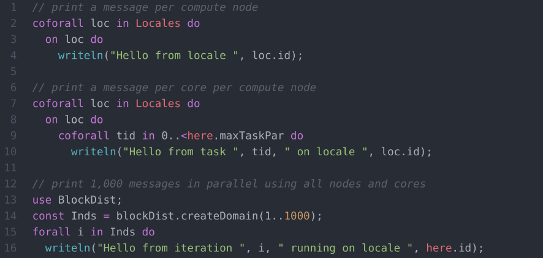
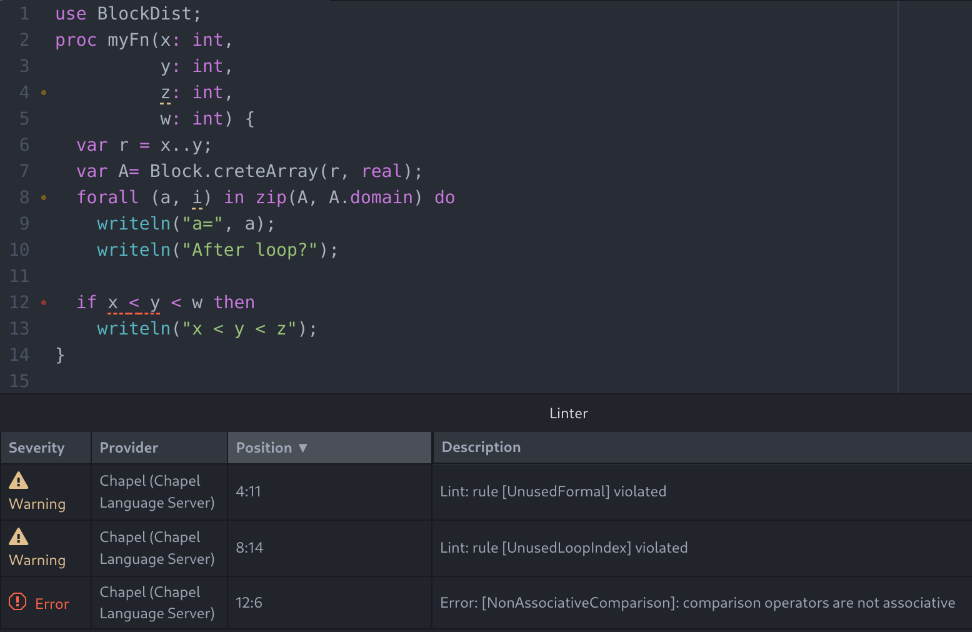

# pulsar-ide-chapel

Chapel support for [Pulsar](https://pulsar-edit.dev/) providing syntax highlighting, linting, and language server support.

**Note:** This package was originally designed as a replacement for the Atom/Pulsar package `fsouza/language-chapel`, which is no longer available.

## Features

- Syntax highlighting

- Linting

- Code snippets

## Language Server Support and Diagnostics

The package provides built-in support for the [Chapel language server](https://chapel-lang.org/docs/tools/chpl-language-server/chpl-language-server.html) and [diagnostics](https://chapel-lang.org/docs/tools/chplcheck/chplcheck.html).
If `chpl-language-server` is available in your `$PATH`, the package will automatically use it.
If not, you can either specify your `CHPL_HOME` in the package settings or specify the path to the executables.

## Contributing

All contributions and feedback are welcome.
